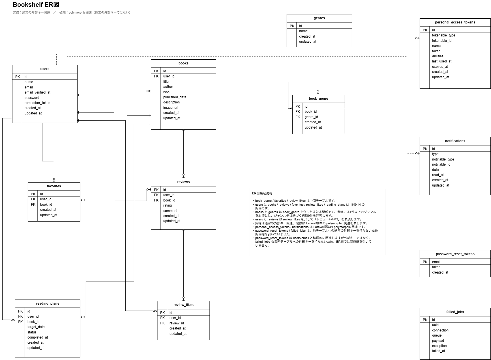

# Bookshelf｜書籍レビューアプリ

**「本を記録する」だけでなく、「見つける・評価する・読み終える」までを支援する書籍管理アプリケーションです。**
Laravel 10を使用し、ブラウザ向けのWeb機能と外部連携向けのREST APIを実装しました。

## 1. アプリ概要

書籍の登録・検索、レビュー、お気に入り、ランキングに加え、読書傾向のレポートや読書計画・リマインダーを利用できます。書籍一覧・詳細などは未ログインでも閲覧でき、登録・編集などの操作にはログインが必要です。

本案件では、提供されたBlade/UIと概要要件を起点に、**画面遷移・認可・バリデーション・例外時の動作を具体化し、クライアント役のPMへの確認を経て設計・実装**しました。

## 2. 主な機能

| 分類 | 実装内容 |
| --- | --- |
| 認証 | 会員登録、ログイン、ログアウト（Laravel Fortify） |
| 書籍 | 一覧・詳細・登録・編集・削除、複数ジャンルの紐付け |
| 検索 | タイトル・著者のキーワード検索、ジャンル絞り込み、ソート、条件を保持するページネーション |
| ISBN検索 | ISBN-13から書籍情報を取得し、登録・編集フォームへ反映 |
| レビュー | 星評価（1〜5）とコメントの投稿・編集・削除、最新順表示 |
| お気に入り・いいね | 登録／解除のトグル、お気に入り一覧、レビューへのいいね |
| ジャンル・ランキング | ジャンル管理、レビュー平均評価による書籍ランキング（上位10冊） |
| 読書レポート | レビュー数、読了冊数、平均評価、評価分布、おすすめ集計など |
| 読書計画・通知 | 読了予定日の管理、状態管理、期限に応じた通知、日次バッチ |
| REST API | 書籍の一覧・詳細・登録・更新・削除、Sanctum認証と所有者認可 |

## 3. 設計・実装で工夫した点

### ユーザーの操作の流れを重視した画面設計

提供UIをそのまま実装するだけでなく、**操作後にユーザーがどこへ進むべきか**を意識して画面遷移を見直しました。

- 書籍登録後は、登録結果をすぐ確認できるよう**その書籍の詳細画面**へ遷移。
- ジャンル詳細画面の「戻る」は書籍一覧ではなく**ジャンル管理画面**へ修正。
- レビュー編集では、選択済み評価を「★★★☆☆」のように**評価値まで連続して着色**し、直感的に確認できるよう改善。
- 会員登録後は独自の `RegisterResponse` を使い、**自動ログインせずログイン画面へ案内**。Fortify本体は変更せずに仕様を実現。
- 操作結果が分かる日本語フラッシュメッセージと、入力をやり直しやすいバリデーション表示を整備。

### ISBN検索の取得率と誤登録防止を両立

`BookIsbnLookupService` に外部API連携を分離し、次の順序で書誌情報を検索します。

**Google Books API → Open Library → openBD**

**フォールバックを設けた理由：** 2026年10月の開発中、Google Books APIの `q=isbn:...` 検索で、書籍が存在するにもかかわらず **HTTP 200／`totalItems: 0`（検索結果0件）** が返る現象を確認しました。一方、通常のキーワード検索では結果が返るケースがあり、同時期にGoogleの開発者向けコミュニティやIssue Trackerでも、ISBNなどのフィールド指定検索が0件になる類似現象が報告されています。Googleによる障害の正式認定を意味するものではありませんが、**1サービスの検索結果だけで書籍が存在しないと判断しない**設計としました。

- [Google Developer forums：Google Books APIのフィールド指定検索で0件になる報告（2026年10月）](https://discuss.google.dev/t/google-books-api-intitle-inauthor-queries-return-zero-results-while-plain-queries-succeed-october-2026/401929)
- [Google Issue Tracker：`q=isbn:` でHTTP 200／検索結果0件となる再現報告](https://issuetracker.google.com/issues/569300353)

**実装上の切り替え条件：** Google Booksが正常応答で「該当なし」の場合にOpen Libraryへ、そこでも該当なしの場合にopenBDへ進みます。Open Libraryでは取得可能な出版日・画像なども反映し、openBDでは取得できるタイトル・著者・ISBNを補完して、不足情報は手入力できるようにしています。**Google BooksのHTTPエラーや通信失敗時は自動フォールバックせず、エラーレスポンス（502）を返します。** これにより「検索結果が0件」と「API自体の障害」を区別します。

また、ISBNを続けて検索した際に出版日が取得できなければ、**前の検索結果の日付をクリア**。別の書籍の出版日が誤って保存されることを防いでいます。応用仕様ではISBN・出版日が未取得でも手入力による書籍登録が可能です。

### セキュリティとデータ整合性

- **WebとAPIを分離**：WebはBlade＋セッション認証、APIは `api/v1` のJSONレスポンスで提供。
- **認証と認可を分離**：APIの書き込みはSanctumのBearerトークンで認証し、書籍の更新・削除は `BookPolicy` で所有者本人に制限。Web側の所有者操作にもPolicyを適用。
- **個人情報を最小限に**：書籍詳細APIのレビュー投稿者情報は `id`・`name` のみに限定。
- **不整合を防止**：Web／APIの書籍登録・更新では、書籍本体の保存とジャンルの `sync()` を `DB::transaction()` にまとめ、途中失敗時にロールバック。
- **Laravel標準機能を活用**：FormRequestによる入力検証、Eloquentのリレーション・Eager Loading、読書計画のEnum／Cast、Collectionを使った集計を採用。

## 4. 使用技術・構成

| 区分 | 技術 |
| --- | --- |
| バックエンド | PHP 8.3系（Laravel Sail 8.3）、Laravel 10.x |
| 認証・認可 | Laravel Fortify、Laravel Sanctum、Policy |
| データベース | MySQL 8.4、Eloquent ORM |
| フロントエンド | Blade、Vite、Tailwind CSS 3、`@tailwindcss/forms`、Alpine.js |
| 開発環境 | Docker Desktop／Docker Compose、Laravel Sail、phpMyAdmin |
| 品質管理 | PHPUnit、Laravel Pint、Git／GitHub |
| 外部連携 | Google Books API、Open Library、openBD |
| 定期処理・通知 | Laravel Console Command、Task Scheduling、Database Notification |

### PHPバージョンの選定理由

要件シートの「開発プロセス」では **PHP 8.5** が指定されています。一度 **PHP 8.5.10** で動作・テストを確認しましたが、テスト処理そのものは成功する一方、Laravel Sanctum 3の `HasApiTokens::createToken()` で **DEPRECATED警告** が発生しました。

そこで、Laravel 10の公式対応範囲に含まれる **PHP 8.3** を実行環境として採用しました。`vendor` 配下のライブラリには手を加えず、PHP 8.3環境で **189件のテストがすべてPASS（661アサーション）、カバレッジ93.8%**、Laravel Pint 164ファイルPASSを確認しています。

## 5. ER図



主なデータは `users`・`books`・`genres`・`reviews`・`reading_plans` を中心に構成しています。`book_genre`・`favorites`・`review_likes` は多対多関係を管理し、複合UNIQUE制約で重複登録を防ぎます。書籍・レビュー削除時には外部キー制約によって関連データの整合性を保ちます。

## 6. 環境構築

### 前提条件

- Docker Desktop（WSL2を使用する場合は対象Linuxディストリビューションとの連携を有効化）
- Git
- ターミナル（以下はWSL／Linuxのbashを想定）
- Webブラウザ

**既存リポジトリをクローンして構築します。新規に `laravel/laravel` プロジェクトを作成する必要はありません。**

### ① リポジトリ取得

```bash
git clone https://github.com/Mussy649/bookshelf-app.git
cd bookshelf-app
```

### ② Composerパッケージのインストール

Sail起動前のため、Docker上のComposerを使用します。

```bash
docker run --rm \
  -u "$(id -u):$(id -g)" \
  -v "$(pwd):/var/www/html" \
  -w /var/www/html \
  -e COMPOSER_CACHE_DIR=/tmp/composer_cache \
  laravelsail/php83-composer:latest composer install
```

### ③ `.env` の作成・設定

```bash
cp .env.example .env
```

`.env` のデータベース接続情報を確認します（ローカル開発用の設定例）。

```dotenv
APP_URL=http://localhost
DB_CONNECTION=mysql
DB_HOST=mysql
DB_PORT=3306
DB_DATABASE=laravel
DB_USERNAME=sail
DB_PASSWORD=password
```

`DB_HOST=mysql` はDocker Compose内のサービス名です。**`.env` はGitにコミットしないでください。**

### ④ コンテナ起動・アプリケーションキー生成

```bash
./vendor/bin/sail up -d
./vendor/bin/sail artisan key:generate
```

### ⑤ フロントエンド構築・DB初期化

```bash
./vendor/bin/sail npm install
./vendor/bin/sail npm run build
./vendor/bin/sail artisan migrate --seed
```

`migrate --seed` は初期構築時に実施してください。**`migrate:fresh --seed` は既存データを削除するため、通常の動作確認では使用しません。**

開発中にViteのホットリロードを使用する場合は、別ターミナルで `./vendor/bin/sail npm run dev` を実行します。

### ⑥ ブラウザで確認

| 画面 | URL |
| --- | --- |
| 書籍一覧（トップ） | http://localhost/books （`/` から遷移） |
| 書籍ランキング | http://localhost/ranking |
| 会員登録／ログイン | http://localhost/register ／ http://localhost/login |
| お気に入り | http://localhost/favorites |
| ジャンル管理 | http://localhost/genres |
| マイ読書レポート | http://localhost/reports |
| 読書計画 | http://localhost/reading-plans |
| 通知一覧 | http://localhost/notifications |
| phpMyAdmin | http://localhost:8080 |

### テスト用ユーザー

Seederによるサンプルユーザーを使用できます（**開発環境専用**）。

| ユーザー | メールアドレス |
| --- | --- |
| 山田太郎 | `yamada@example.com` |
| 鈴木花子 | `suzuki@example.com` |
| 田中一郎 | `tanaka@example.com` |
| 佐藤美咲 | `sato@example.com` |
| 高橋健太 | `takahashi@example.com` |

初期パスワードは共通で `password` です。初期データにはジャンル・書籍・レビュー・お気に入り等も含まれます。

### Basic版の確認（Gitタグ）

本アプリは**Basicの完成版を保存した後、同一リポジトリでAdvanced機能を追加**しています。最終提出版はBasicの機能を含むAdvanced版です。Basic完成時点のソースコードはGitタグ **`basic-v1.0`** で参照できます。

```bash
# Basic完成時点のコミットと変更ファイルを確認
git fetch --tags
git show --stat basic-v1.0

# 現在のAdvancedの作業ツリーを変更せず、Basicのソースを別フォルダに展開
git worktree add --detach ../bookshelf-basic basic-v1.0
```

これにより `../bookshelf-basic` でBasic当時のソース・Bladeを確認できます。**画面上の `/basic` などでBasic／Advancedを切り替える機能ではありません。** Basic版を実際に起動する場合は、Advanced版とポート・データベースを分離した検証環境を用意してください。既存のAdvanced環境で `migrate:fresh` は実行しないでください。

## 7. REST API

ベースURL：`http://localhost/api/v1`

| メソッド | エンドポイント | 概要 | 認証 |
| --- | --- | --- | --- |
| GET | `/books` | 書籍一覧・検索・絞り込み・ページネーション | 不要 |
| GET | `/books/{book}` | 書籍詳細・ジャンル・レビュー取得 | 不要 |
| POST | `/books` | 書籍登録 | Sanctum必須 |
| PUT / PATCH | `/books/{book}` | 書籍更新 | Sanctum＋所有者認可 |
| DELETE | `/books/{book}` | 書籍削除 | Sanctum＋所有者認可 |

GET一覧では `keyword`（タイトル・著者・ISBN）、`genre`、`page`、`per_page` を指定できます。`per_page` は省略時10件、最大10件です。

書き込み系APIには `Authorization: Bearer <token>` ヘッダーが必要です。未認証時は `401`、他人の書籍への更新・削除は `403`、対象なしは `404`、入力不正は `422` を返します。POSTではトークン認証したユーザーを書籍登録者として保存します。

ローカルでのAPI動作確認に使用するトークンは、例えばTinkerで開発用ユーザーから発行できます。発行されたトークンは秘密情報として管理してください。

```bash
./vendor/bin/sail artisan tinker
```

```php
$user = App\Models\User::where('email', 'yamada@example.com')->first();
$token = $user->createToken('local-api-test')->plainTextToken;
$token;
```

## 8. 読書計画の日次バッチ・通知

読書計画の状態を管理し、**読了予定日の3日前・当日・3日後**を基準に通知を作成します。通知はデータベースに保存され、画面で未読件数や既読状態を確認できます。

手動実行：

```bash
./vendor/bin/sail artisan reading-plans:process-daily
```

スケジュール確認：

```bash
./vendor/bin/sail artisan schedule:list
```

Laravelのスケジュールには**毎日20:00（Asia/Tokyo）**の実行を設定しています。ローカルで定刻実行を動作させる場合は、別ターミナルで次のスケジューラーを継続実行してください。

```bash
./vendor/bin/sail artisan schedule:work
```

> スケジュール定義だけでは、自動実行用プロセスが停止している間は処理されません。手動バッチは実データの状態・通知を変更するため、動作検証はテスト用データで行ってください。

## 9. テスト・コード品質

```bash
# 全自動テスト
./vendor/bin/sail artisan test

# コードカバレッジ
./vendor/bin/sail artisan test --coverage

# コードスタイル確認（自動修正なし）
./vendor/bin/sail pint --test
```

**2026年10月の最終確認結果**

| 項目 | 結果 |
| --- | --- |
| PHPUnit | **189件PASS／661アサーション** |
| コードカバレッジ | **93.8%**（目標80%以上） |
| Laravel Pint | **164ファイルPASS** |
| DBトランザクション | Web・APIの登録／更新でロールバックテスト4件PASS |

通常のCRUDに加え、認証・認可（401／403）、バリデーション（422）、存在しないデータ（404）、外部API障害、状態遷移、DBのロールバックを検証しています。

## 10. 要件定義・設計資料について

**[Bookshelf 要件シート（Google スプレッドシート）](https://docs.google.com/spreadsheets/d/1uZYgQeMs9tB64eSfJ9rYqkO2QHhQmEchHGo40T4S1zw/edit?gid=2057035660#gid=2057035660)**

本案件は、概要要件から詳細仕様を設計し、クライアント役のPMに提案・確認しながら進める形式です。提出用の要件シートでは**元の要件・UIを残したまま、実装に対応する設計資料を追加・更新**しています。リンク先の閲覧には共有設定に応じたアクセス権限が必要です。

| 資料（要件シート内） | 役割 |
| --- | --- |
| シート5-2 | Route・Controller・Action・Modelなどの基本設計 |
| シート6-1／6-2 | Basic／Advancedの実装反映版UI（元UIは6-0に保存） |
| シート7-1／7-2／7-3 | 実装用の機能要件、提供Bladeの修正記録、フラッシュメッセージ仕様 |
| シート8 | フォーム・APIのバリデーションと日本語エラーメッセージ |
| シート10-1／10-2 | 実装反映版テスト要件と189件のテストケース一覧（元要件は10-0に保存） |
| シート12／13 | テーブル仕様書とER図 |
| シート14 | APIエンドポイント・認証・レスポンスの詳細仕様 |
| クライアント報告 | ヒアリング結果、確認事項、設計判断、進捗・実施結果を管理 |

シート2「あなたのタスク」で求められる**PMへのヒアリング記録は、コーチ側で用意された「クライアント報告」シートに集約**しています。追加・更新した資料は、提出用ブック内でマゼンタ色のシート見出しを目印にしています。

なお、提供元のUI・要件資料やクライアント報告の詳細は、公開用リポジトリには含めない運用を想定しています。

## 11. 仕様上の補足

- **Basic／Advancedの違い**：Basicでは書籍のISBN-13・出版日が必須、実装済みAdvancedでは任意です。
- **削除制限**：書籍が紐づいているジャンルは削除できません。自分が投稿したレビューにはいいねできません。
- **CSV出力**：提供UIとの整合性をクライアントに確認し、今回の実装対象外としました。
- **レビュー・認可**：レビューの編集・削除は投稿者本人のみ。バリデーションはFormRequest、所有者確認はPolicyで責務を分離しています。

## 作成者

桝田 睦郎
